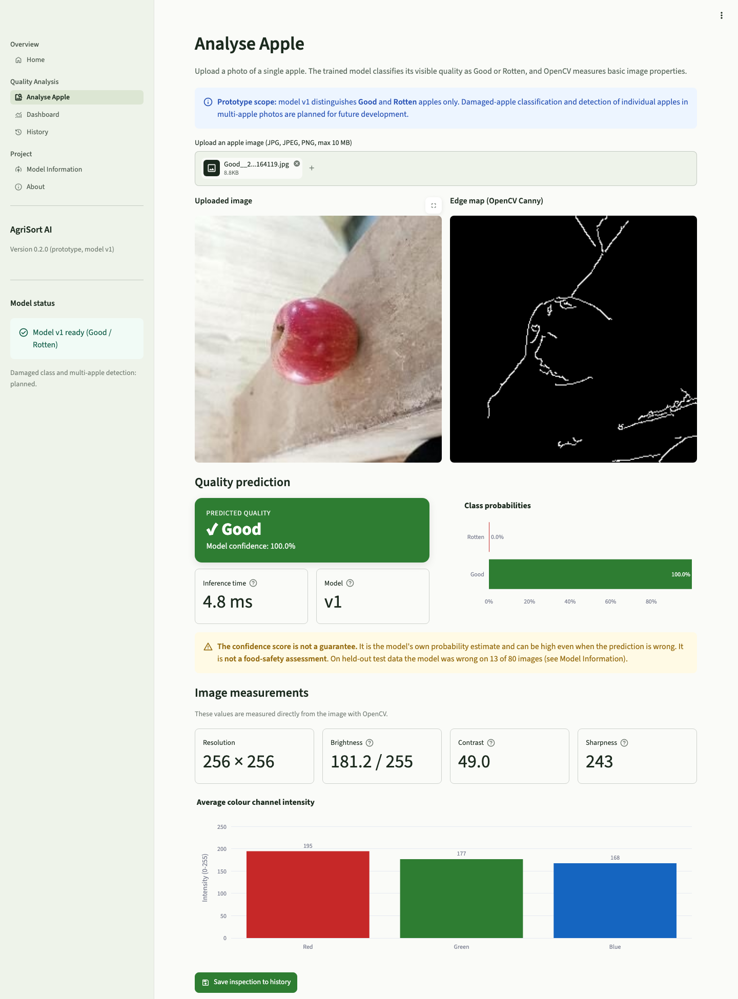
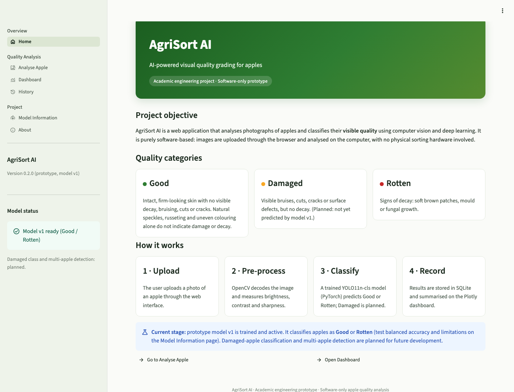
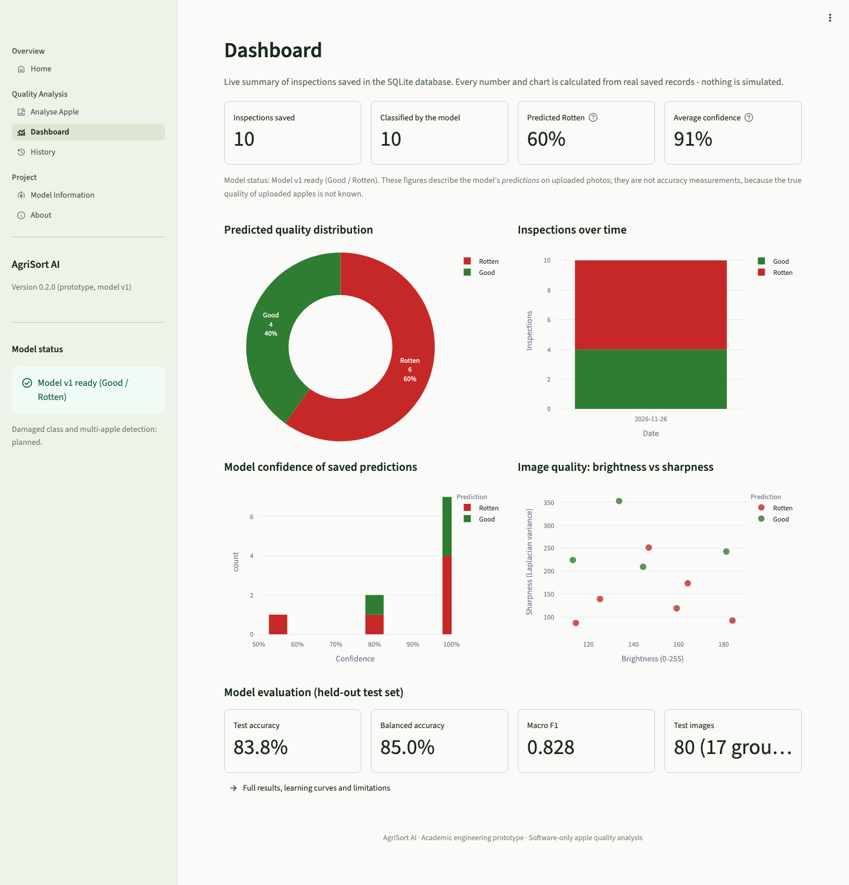
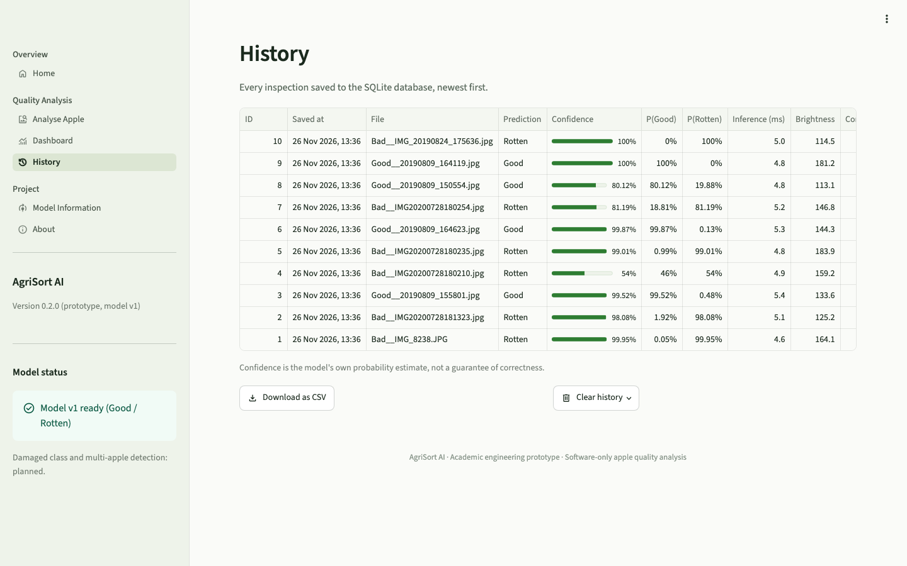
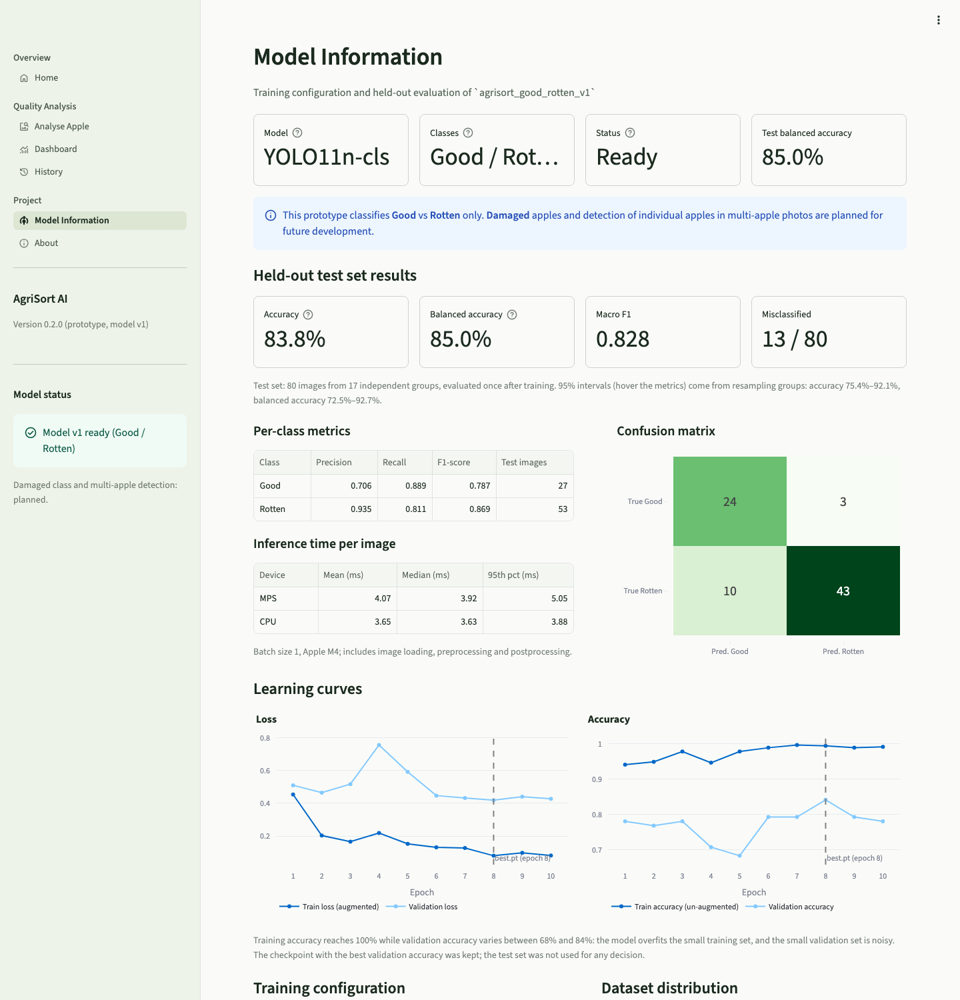
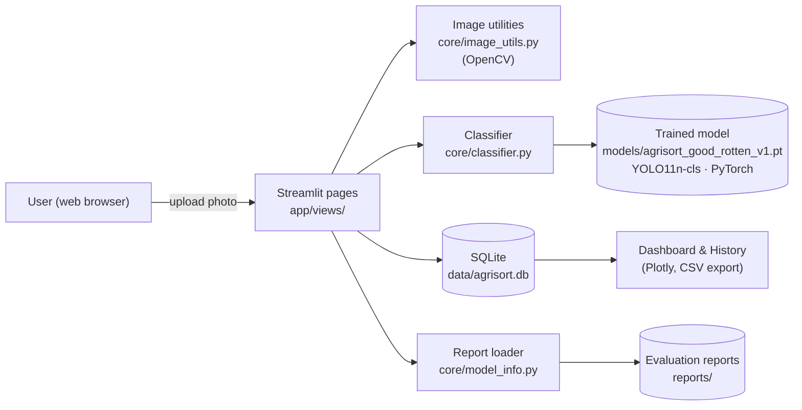

# AgriSort AI

**AI-powered visual quality grading for apples: an academic engineering prototype.**

AgriSort AI is a web application that analyses a photo of an apple and classifies its visible quality using computer vision and deep learning. You upload an image in the browser and get:
- a prediction from a trained neural network, with a confidence score and class probabilities
- image measurements from OpenCV

Every inspection can be saved, reviewed and exported. It is a **software-only** project: there is no hardware, IoT or physical sorting.

   

> **Current prototype (model v1):** classifies a single-apple photo as **Good** or **Rotten**. On a held-out test set of 80 images it reached **83.8% accuracy and 85.0% balanced accuracy** (details and limitations below). A **Damaged** class and detection of individual apples in multi-apple photos are planned.



---

## Contents

[Problem statement](#problem-statement) · [Objectives](#objectives) · [Features](#features) · [Screenshots](#screenshots) · [Architecture](#system-architecture) · [Technology](#technology-stack) · [Project structure](#project-structure) · [Installation](#installation) · [Usage](#usage) · [Trained model](#trained-model) · [Dataset](#dataset-and-attribution) · [Performance](#model-performance) · [Limitations](#known-limitations) · [Roadmap](#roadmap) · [Contributing](#contributing) · [Team](#team) · [Licence](#licence)

## Problem statement

Fruit is often graded for quality by eye. That is slow and subjective, and results depend on the person doing it. Damaged or rotting fruit that is missed can spoil nearby fruit and lead to waste. This project explores whether a small, fast image classifier can give a **consistent first assessment of visible apple quality from an ordinary photo**, and how honestly such a system can be evaluated when only a small public dataset is available.

## Objectives

1. Build a usable web application that accepts an apple photo and returns a quality prediction with a confidence score.
2. Prepare a **trustworthy dataset**:
   - Use an openly licensed source (FruitNet, CC BY 4.0) and relabel it by hand.
   - Use a **group-aware split**, so near-identical burst photos of the same apple never appear in both training and test sets.
3. Train a lightweight deep-learning classifier using transfer learning, and evaluate it **once** on a held-out test set.
4. Record every inspection in a database and summarise the results on a dashboard.
5. Report results and limitations honestly: no invented numbers, no sample data.

## Features

| Page | What it does |
|---|---|
| **Home** | Project overview, quality categories, how it works and the current model status. |
| **Analyse Apple** | Upload a JPG or PNG photo (up to 10 MB). It shows:<ul><li>the predicted class (✔ Good / ✖ Rotten), the model confidence and both class probabilities</li><li>the inference time</li><li>an OpenCV edge map, brightness, contrast, sharpness (with a blur warning) and colour-channel intensities</li></ul>You can then save the inspection to history. |
| **Dashboard** | Statistics and interactive Plotly charts calculated **only from saved inspections**:<ul><li>prediction distribution</li><li>inspections over time</li><li>confidence histogram</li><li>brightness vs sharpness</li></ul>It also shows a summary of the held-out test results. When nothing has been saved, it shows an empty-state message. |
| **History** | A table of every saved inspection (SQLite), with CSV export and an option to clear the history. |
| **Model Information** | Training configuration, test metrics, confusion matrix, learning curves, dataset distribution and limitations. Everything is read from the report files in `reports/`. |
| **About** | Scope, technology stack and development roadmap. |

The app never fabricates a prediction. If the model file is missing or an image can't be classified, it says so and shows no result.

A separate **labelling tool** (`labelling/label_tool.py`) was used to relabel the dataset by hand. Keyboard shortcuts, batches for several annotators and a review mode for flagged images are described in [labelling/README.md](labelling/README.md).

## Screenshots

All screenshots show the real application running model v1. The example photos are FruitNet images from the held-out test set (CC BY 4.0, see [attribution](#dataset-and-attribution)), and every prediction shown is the model's genuine output.

| Home | Dashboard |
|---|---|
|  |  |
| **History** | **Model Information** |
|  |  |

## System architecture



**How a prediction works:**
1. OpenCV decodes the uploaded image and measures it.
2. The YOLO11n-cls model (on the CPU) resizes it to 224 px and outputs a probability for each class.
3. The page shows the result, and you can save it to SQLite.

The model is loaded once and cached, with a short warm-up. All paths, class names and colours live in `app/core/config.py`.

**Offline pipeline**, used to create the model (not needed to run the app):

```
FruitNet zip → extract apples → audit (duplicates, bursts, leakage groups) → human labelling
→ merge labels → group-aware split → leakage verification → train YOLO11n-cls → evaluate once on test
```

## Technology stack

| Layer | Technology |
|---|---|
| Web interface | Streamlit 1.67 |
| Language | Python 3.12 |
| Deep learning | PyTorch 2.15 |
| Model | Ultralytics YOLO11n-cls (8.4.218), transfer learning from ImageNet |
| Image processing | OpenCV 5.1 |
| Database | SQLite (built into Python) |
| Charts | Plotly 7.2 |
| Testing | pytest |

## Project structure

```
AgriSort-AI/
├── app/                      # Streamlit web application
│   ├── main.py               # entry point: page setup, navigation, sidebar
│   ├── views/                # Home, Analyse Apple, Dashboard, History, Model Information, About
│   ├── components/ui.py      # shared styling and UI elements
│   └── core/                 # config, database, image utilities, classifier, report loader
├── models/
│   ├── agrisort_good_rotten_v1.pt   # trained model v1 (3.2 MB, included)
│   └── README.md             # model card and checksums
├── reports/agrisort_good_rotten_v1/ # training log, metrics, figures, REPORT.md
├── data/labels/              # human annotations (CC BY 4.0)
├── data/{raw,processed}/     # dataset location for retraining (empty in git)
├── labelling/                # standalone labelling tool
├── scripts/                  # dataset pipeline, training and evaluation
├── tests/                    # automated tests (pytest)
├── docs/DATASET.md           # dataset card: source, licence, audit, labelling, split
├── docs/screenshots/         # README images
├── .streamlit/config.toml    # theme and upload limit
├── requirements.txt          # runtime dependencies (pinned)
├── requirements-dev.txt      # + test tools
├── packages.txt              # system libraries for a future Streamlit Community Cloud deployment
├── LICENSE · NOTICE.md       # licences and attribution
└── CONTRIBUTING.md           # how to contribute
```

## Installation

**Requirements:**
- **Python 3.12** (developed and tested with 3.12.16)
- Git
- About 1.5 GB of free disk space for the packages (mainly PyTorch)

You **don't** need the dataset or a GPU, and you don't need to train anything: the trained model is included.

> **Tested platforms.** Installation, the tests and the app have been verified on **macOS (Apple Silicon)**, including a fresh clone in a new environment. The **Windows and Linux instructions below have not been tested yet**: they follow the standard steps for those systems, and all pinned packages publish Python 3.12 wheels for them. **Intel-based Macs aren't supported**, because PyTorch 2.15 no longer provides Intel macOS builds. Please [open an issue](../../issues) if something doesn't work.

### macOS (Apple Silicon) ✅ tested

```bash
git clone https://github.com/Armaan-Das/AgriSort-AI.git
cd AgriSort-AI
python3.12 -m venv .venv           # install Python 3.12 first if needed, e.g. `brew install python@3.12`
source .venv/bin/activate
pip install --upgrade pip
pip install -r requirements.txt
```

### Windows 10/11 ⚠️ untested

Install Python 3.12 from [python.org](https://www.python.org/downloads/) (tick *Add python.exe to PATH*), then in **PowerShell**:

```powershell
git clone https://github.com/Armaan-Das/AgriSort-AI.git
cd AgriSort-AI
py -3.12 -m venv .venv
.venv\Scripts\Activate.ps1          # if blocked: Set-ExecutionPolicy -Scope CurrentUser RemoteSigned
python -m pip install --upgrade pip
pip install -r requirements.txt
```

### Linux (x86-64 or ARM64) ⚠️ untested

```bash
git clone https://github.com/Armaan-Das/AgriSort-AI.git
cd AgriSort-AI
python3.12 -m venv .venv            # e.g. `sudo apt install python3.12 python3.12-venv`
source .venv/bin/activate
pip install --upgrade pip
# Recommended: install the CPU-only PyTorch build first (about 200 MB instead of several GB of CUDA libraries)
pip install torch==2.15.0 --index-url https://download.pytorch.org/whl/cpu
pip install -r requirements.txt
```

If OpenCV complains about `libGL.so.1`, install the system libraries: `sudo apt install libgl1 libglib2.0-0`.

## Usage

### Run the web app

From the project folder, with the virtual environment activated:

```bash
streamlit run app/main.py
```

Open **http://localhost:8501**. Then:
1. Go to **Analyse Apple** and upload a clear photo of **one apple**.
2. Read the prediction, confidence and image measurements, then click **Save inspection to history**.
3. Saved inspections appear on **History** (with CSV export) and **Dashboard**.

Stop the app with `Ctrl+C`. If port 8501 is busy, add `--server.port 8503`.

Saved inspections are stored locally in `data/agrisort.db`, which is created automatically and never committed to git. Only the file name and the measurements are stored, not the photo itself.

### Run the tests

```bash
pip install -r requirements-dev.txt
python -m pytest tests -q
```

The tests use a temporary database and never touch `data/agrisort.db`. They include real model predictions and the full upload → predict → save → History → Dashboard workflow. A few tests need the original dataset and are **skipped automatically** when it isn't present.

### Labelling tool (only needed to extend the dataset)

```bash
streamlit run labelling/label_tool.py --server.port 8502
```

## Trained model

The trained model **`models/agrisort_good_rotten_v1.pt` (3.2 MB) is included in the repository**, so a fresh clone can make real predictions immediately. The same file is also attached to the [v0.2.0 GitHub release](../../releases/tag/v0.2.0), together with its checksum.

| | |
|---|---|
| Classes | Good, Rotten |
| Architecture | YOLO11n-cls, 1.53 M parameters, input 224 × 224 |
| SHA-256 | `29f7f67e7a935c38ba246b4cdb14ecf6636a907f9e91c5b156c1ce2b641cc7c0` |
| Licence | AGPL-3.0-or-later, © 2026 AgriSort AI Team |

Before publication, local folder paths were removed from the training metadata stored inside the file. **The network weights were not changed**: all 1,543,865 stored values are identical, and the predictions on all 80 test images are identical. See the [model card](models/README.md).

## Dataset and attribution

Apple images come from **FruitNet: Indian Fruits Dataset with quality (Good, Bad & Mixed quality)** by V. Meshram and K. Patil (Mendeley Data, version 3, 2022, DOI [10.17632/b6fftwbr2v.3](https://doi.org/10.17632/b6fftwbr2v.3); article: *Data in Brief* 40, 2022, 107686). The dataset is licensed under [**CC BY 4.0**](https://creativecommons.org/licenses/by/4.0/).

**Changes we made:**
- We extracted the apple images only (2,403 images).
- We audited them for corruption, duplicates and burst photography.
- People **relabelled** them into Good / Damaged / Rotten / Exclude. FruitNet's original labels were Good / Bad / Mixed.

| | Good | Rotten | Total |
|---|---|---|---|
| Train | 117 | 259 | 376 |
| Validation | 32 | 50 | 82 |
| Test (held out) | 27 | 53 | 80 |

The split is **group-aware**: burst photos and near-duplicates of the same apple always stay in the same set, and an independent leakage check passed. The 65 Damaged labels are kept for future work.

**What is and isn't in this repository:**
- **Included:** the human annotations (`data/labels/`, CC BY 4.0) and the trained model.
- **Not included:** the full dataset. Download it from the source (instructions in [docs/DATASET.md](docs/DATASET.md)).
- **Some FruitNet images do appear in this repository** inside report figures (`reports/agrisort_good_rotten_v1/ultralytics/*_batch*.jpg` and `test_evaluation/misclassified.jpg`) and in the screenshots. They're used under CC BY 4.0 with this attribution.

The full source, audit and labelling records are in [docs/DATASET.md](docs/DATASET.md).

## Model performance

Held-out test set: 80 images from 17 independent groups, **evaluated once**, after all training decisions were made. Model: YOLO11n-cls, 224 px, 10 epochs, batch 16, class-weighted loss, trained on an Apple M4 GPU (MPS) in 38 s.

| Metric | Value | 95% interval (resampling the 17 test groups) |
|---|---|---|
| Accuracy | **0.838** (67 / 80) | 0.754 – 0.921 |
| Balanced accuracy | **0.850** | 0.725 – 0.927 |
| Macro F1 | **0.828** | |

| Class | Precision | Recall | F1 | Test images |
|---|---|---|---|---|
| Good | 0.706 | 0.889 | 0.787 | 27 |
| Rotten | 0.935 | 0.811 | 0.869 | 53 |

Confusion matrix (rows = true class):
- **Good:** 24 correct, 3 predicted Rotten.
- **Rotten:** 43 correct, 10 predicted Good.

Median inference time is 3.6 ms per image on the CPU of an Apple M4. The full report, with learning curves and error analysis, is in [reports/agrisort_good_rotten_v1/REPORT.md](reports/agrisort_good_rotten_v1/REPORT.md).

## Known limitations

1. **Two classes only.** Damaged apples are forced into Good or Rotten. Photos that don't show apples still get a Good/Rotten answer, and multi-apple photos are classified as a whole.
2. **Small test set:** 80 images from only 17 independent groups, so the intervals above are wide.
3. **Camera and background bias:**
   - Most Rotten photos show a single apple held in a hand against a wall, and 217 come from one phone.
   - 6 of the 10 missed rotten test images show two apples on a plain surface, which suggests the model partly relies on the setting.
4. **Class imbalance (1 Good : 2.1 Rotten),** handled with verified class-weighted loss.
5. **Approximate grouping:** the same apple photographed more than 20 s apart can't be detected, so the results may be slightly optimistic.
6. **One annotator and one dataset.** The model hasn't been tested on new photos, other varieties or other lighting.
7. **The confidence score is not a guarantee of correctness, and the app is not a food-safety assessment.**
8. **Platform testing:** verified on macOS (Apple Silicon) only. Windows and Linux are untested.

## Roadmap

- [x] Web application, OpenCV analysis, SQLite history and dashboard
- [x] FruitNet dataset audit and manual relabelling (round 1)
- [x] Train and evaluate YOLO11n-cls (Good vs Rotten) on a held-out test set
- [x] Integrate the model into the website, with genuine metrics
- [ ] Add the Damaged class (more labelled data) and test on new, independent photos
- [ ] Detect and grade individual apples in multi-apple photos
- [ ] Test installation on Windows and Linux
- [ ] Optional: public demo on Streamlit Community Cloud (see below)

### Deployment notes (Streamlit Community Cloud, not yet deployed)

The repository is prepared for, but **not yet deployed to**, Streamlit Community Cloud:
- **Main file:** `app/main.py`
- **Python version:** choose 3.12
- **System libraries:** `packages.txt` installs the OpenCV dependencies

Two caveats:
- **Database:** the cloud file system is temporary, so saved history would be lost whenever the app restarts.
- **The AGPL applies:** a hosted modified version must offer its source code to users. Linking to this repository satisfies that.

## Reproducing the pipeline

This is only needed to retrain or re-evaluate the model, and it requires the FruitNet download (3.25 GB):

```bash
python scripts/fruitnet_extract.py                             # verify download + extract apples
python scripts/fruitnet_audit.py --session-gap 20 --threshold 8 # duplicates, near-duplicates, groups
streamlit run labelling/label_tool.py --server.port 8502       # manual labelling + review
python scripts/merge_labels.py
python scripts/build_yolo_dataset.py --classes Good Rotten     # group-aware 70/15/15 split
python scripts/verify_split.py                                 # independent leakage check
python scripts/train_classifier.py --name <new_run_name>       # YOLO11n-cls training
python scripts/evaluate_classifier.py --weights models/<new_run_name>.pt
```

Training also needs Ultralytics' pretrained `yolo11n-cls.pt` in `models/pretrained/`.

## Contributing

Contributions from team members are welcome. Please read [CONTRIBUTING.md](CONTRIBUTING.md) for:
- the branch and pull-request workflow
- the project's honesty rules (no fabricated results)
- what must never be committed

## Team

AgriSort AI is developed and maintained by the **AgriSort AI Team**, a team of six students, as an academic engineering project. All work is credited collectively to the team.

## Licence

| Part | Licence |
|---|---|
| Source code and trained model | [GNU AGPL-3.0-or-later](LICENSE) |
| Human annotations (`data/labels/`) | [CC BY 4.0](data/labels/LICENSE.md) |
| FruitNet images appearing in reports and screenshots | CC BY 4.0, © V. Meshram & K. Patil |

AgriSort AI uses [Ultralytics YOLO](https://github.com/ultralytics/ultralytics), which is licensed under AGPL-3.0. This project is therefore released under the same licence. Full attribution and third-party licences are in [NOTICE.md](NOTICE.md).
