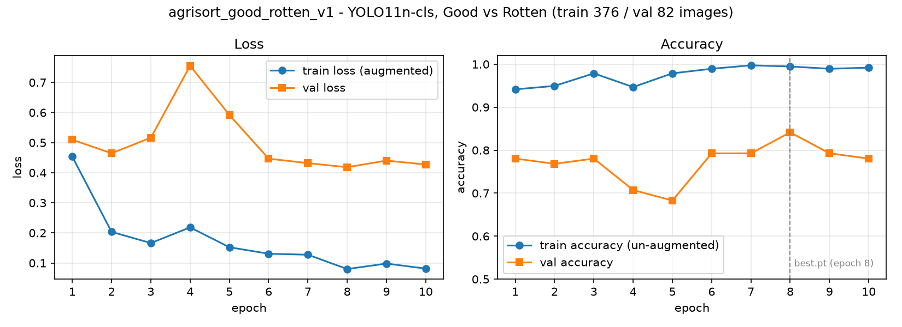
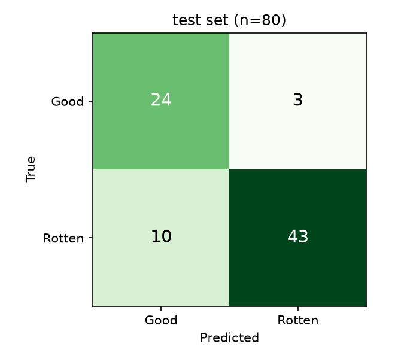
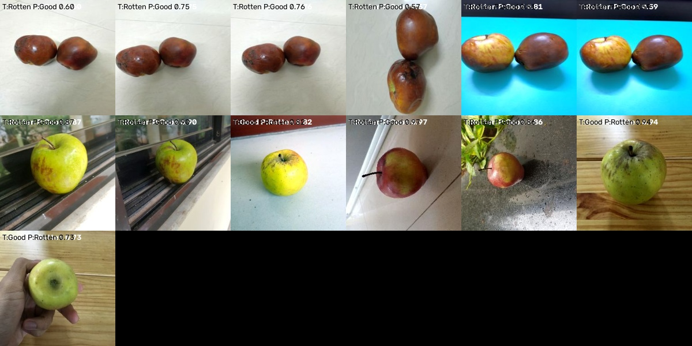

# AgriSort AI: training and evaluation report, `agrisort_good_rotten_v1`

*Trained on 25 November 2026. Two-class prototype (Good vs Rotten). All numbers below come from the files in this folder; none are estimated or invented.*

## 1. Setup

| Item | Value |
|---|---|
| Task | Image classification: **Good** vs **Rotten** apple (the Damaged class is planned for the final project) |
| Model | YOLO11n-cls (2.8 M parameters), **transfer learning** from ImageNet-pretrained `yolo11n-cls.pt` (234 of 236 weight tensors transferred; the new 2-class output layer was trained from scratch) |
| Data | `data/processed/fruitnet_cls/`: FruitNet apples (CC BY 4.0), relabelled by hand, group-aware split, leakage check passed (see `docs/DATASET.md` §9) |
| Split | train 376 (Good 117 / Rotten 259) · val 82 (32 / 50) · **test 80 (27 / 53), 17 independent groups** |
| Settings | imgsz 224, 10 epochs, batch 16, seed 42, `deterministic=True`, optimizer auto → AdamW (lr 0.001667), Ultralytics default classification augmentation (RandAugment, random erasing 0.4, horizontal flip) |
| Class imbalance | Class-weighted cross-entropy, `cls_pw=1.0` (inverse frequency) |
| Hardware | Apple M4 MacBook Air, **MPS** (Apple GPU); the CPU fallback wasn't needed |
| Software | Python 3.12.16, PyTorch 2.15.0, Ultralytics 8.4.218 |
| **Training time** | **38.0 s** for 10 epochs |

### Class weights were checked, not assumed

`training_summary.json → class_weight_check` reads the weights from the **live loss function** (`v8ClassificationLoss`) after the first epoch:

| | Good | Rotten |
|---|---|---|
| Training images | 117 | 259 |
| Expected weight (inverse frequency, normalised to mean 1) | 1.3777 | 0.6223 |
| Weight in the model | 1.3777 | 0.6223 |
| Weight in the loss function | 1.3777 | 0.6223 |

`applied_correctly: true`. A mistake on a Good image therefore costs about 2.2× more than a mistake on a Rotten image.

## 2. Training and validation curves



| Epoch | Train loss | Train acc.* | Val loss | Val acc. |
|---|---|---|---|---|
| 1 | 0.453 | 0.941 | 0.510 | 0.780 |
| 2 | 0.203 | 0.949 | 0.465 | 0.768 |
| 3 | 0.166 | 0.979 | 0.516 | 0.780 |
| 4 | 0.218 | 0.947 | 0.755 | 0.707 |
| 5 | 0.152 | 0.979 | 0.592 | 0.683 |
| 6 | 0.131 | 0.989 | 0.447 | 0.793 |
| 7 | 0.127 | 0.997 | 0.432 | 0.793 |
| **8** | 0.080 | 0.995 | **0.418** | **0.841** ← `best.pt` |
| 9 | 0.098 | 0.989 | 0.440 | 0.793 |
| 10 | 0.081 | 0.992 | 0.427 | 0.780 |

\*Training accuracy is measured on **un-augmented** training images using the same weights that are validated. Ultralytics doesn't report it, so `train_classifier.py` adds it. Training loss is the running mean over augmented batches.

**Interpretation**
- There's a clear **gap between training and validation accuracy** (≈ 99% vs 78–84%). The model fits the training images almost perfectly but generalises less well. That's expected with 376 training images from about 29 independent groups.
- Validation accuracy **moves by ±8 points between epochs**, because the validation set has only 82 images from 19 groups. The best checkpoint was picked on this noisy validation set, so its validation score (0.841) is probably slightly optimistic.
- **No changes were made after seeing these curves**, and the test set wasn't used for any decision.

## 3. Held-out test set results (evaluated once)

`python scripts/evaluate_classifier.py --weights models/agrisort_good_rotten_v1.pt` produced `test_evaluation/metrics.json`.

| Metric | Value | 95% interval (group bootstrap*) |
|---|---|---|
| **Accuracy** | **0.838** (67 / 80) | 0.754 – 0.921 |
| **Balanced accuracy** | **0.850** | 0.725 – 0.927 |
| **Macro F1** | **0.828** | |

| Class | Precision | Recall | F1 | Test images |
|---|---|---|---|---|
| Good | 0.706 | 0.889 | 0.787 | 27 |
| Rotten | 0.935 | 0.811 | 0.869 | 53 |

**Confusion matrix** (rows = true, columns = predicted)

| | Predicted Good | Predicted Rotten |
|---|---|---|
| **True Good** | 24 | 3 |
| **True Rotten** | 10 | 43 |



\*The interval comes from resampling the 17 independent **groups** (not individual images) 2,000 times. Images in a group are near-copies of the same apple or session, so resampling images would understate the uncertainty.

### Inference time (one image at a time, M4)

| Device | Mean | Median | 95th percentile |
|---|---|---|---|
| MPS (GPU) | 4.07 ms | 3.92 ms | 5.05 ms |
| CPU | 3.65 ms | 3.63 ms | 3.88 ms |

The times include reading the image file, preprocessing, the model itself and postprocessing, measured over 80 test images after a 5-image warm-up. With such a small model, the CPU is as fast as the GPU at batch size 1.

## 4. Error analysis (13 mistakes)



- **10 Rotten apples were predicted Good, and 3 Good apples predicted Rotten.** The main weakness is *missing* rotten apples: Rotten recall is 0.81.
- **6 of the 10 missed rotten apples are photos of 2 clearly rotten, dark-brown apples on a plain white or cyan surface.** Those photos are near-repeats from 3 shoots (groups 1, 3 and 44). Most rotten training images are single apples held in a hand, so this suggests the model partly relies on **setting and composition** rather than decay alone.
- The other errors are borderline cases. Four green or red apples from FruitNet's Good folder were labelled Rotten during the manual review, and three Good apples have russet or speckles.
- Errors fall in **7 of the 17 test groups**, with up to 4 errors in a single group.
- Wrong predictions had **confidences of 0.57–0.97**, so a confidence threshold alone wouldn't filter out the errors.

## 5. Limitations

1. **Small, clustered test set:** 80 images from only **17 independent groups**. The 95% intervals above are wide; balanced accuracy could plausibly be anywhere from about 0.72 to 0.93.
2. **Camera bias:** 217 Rotten images come from a ZUK Z2 Plus session with no Good images from that camera. Camera colour processing may be used as a cue.
3. **Background and composition bias:** Rotten apples are mostly single, hand-held, against walls. Good apples are often on floors, ledges or cloth. The error pattern (§4) supports this concern.
4. **Class imbalance (1 : 2.1):** handled with class-weighted loss, which was verified. Precision and recall still differ between the classes.
5. **Approximate grouping:** the same apple photographed more than 20 s apart from a very different angle can't be detected, so some hidden leakage is possible. If so, it would make the results look slightly better than they really are.
6. **Single annotator, no agreement measure.** The boundary between russet or speckles (Good) and early rot is subjective.
7. **Only one dataset (FruitNet, Indian apple varieties, phone photos).** The model hasn't been tested on new photos, other varieties or other lighting. It should be checked on fresh images before any claim of real-world accuracy.
8. **There's no Damaged class yet.** A damaged apple will be forced into Good or Rotten.

## 6. Reproduce

```bash
python scripts/train_classifier.py          # needs models/pretrained/yolo11n-cls.pt and the prepared dataset
python scripts/evaluate_classifier.py --weights models/agrisort_good_rotten_v1.pt
```

Results may vary slightly between runs on MPS, even with a fixed seed, because some GPU operations aren't perfectly deterministic.

## 7. Files

| File | Contents |
|---|---|
| `training_summary.json` | Settings, device, duration, class-weight check, best epoch |
| `epoch_metrics.csv`, `learning_curves.png` | Per-epoch loss and accuracy |
| `train_log.txt` | Full console log of the successful run |
| `train_log_attempt1_crashed.txt` | First attempt: crashed in epoch 1 because of a bug in our logging code (not the model). The run was discarded and restarted. |
| `ultralytics/` | Ultralytics' own `results.csv`, `results.png`, validation confusion matrices and batch previews |
| `test_evaluation/` | `metrics.json`, `predictions.csv` (every test prediction), `confusion_matrix.png`, `misclassified.jpg` |
| Weights (not in git) | `models/agrisort_good_rotten_v1.pt` (= `runs/classify/agrisort_good_rotten_v1/weights/best.pt`, 3.2 MB) |
